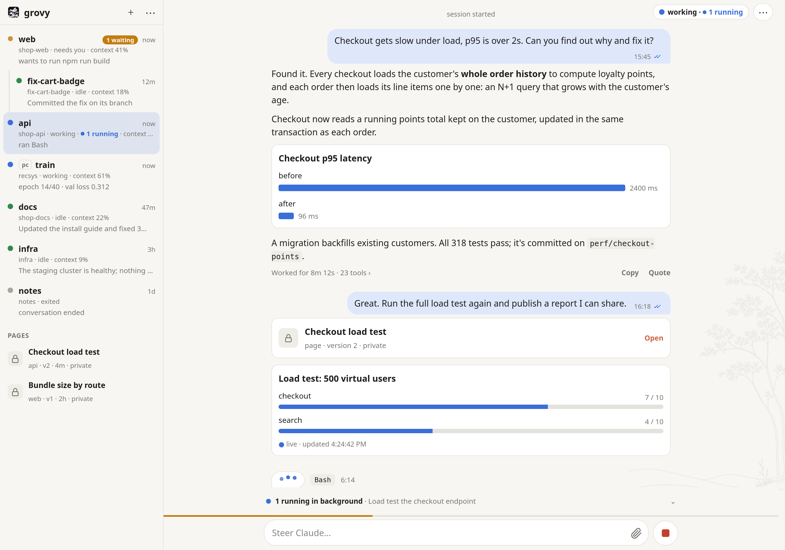
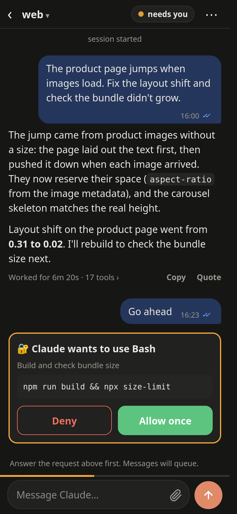

<h1> grovy</h1>

**Your Claude sessions, in any browser.**<br/>
<a href="#install">install</a> · <a href="docs/guide.md">guide</a> · <a href="docs/setup.md">setup</a> ·
<a href="docs/customize.md">make it yours</a> · <a href="docs/troubleshooting.md">troubleshooting</a>

<p align="center">
  
  &nbsp;
  
</p>

Your Claude sessions run on your computer, in tmux, exactly as if you had typed `claude`. grovy gives them a web
page you open on your phone (or any browser) over your home network or VPN. Nothing to install on the phone.

- **See every session at a glance:** working, idle or waiting on you, with context used and the last thing it did.
- **Approve from anywhere:** the full command or diff, then Allow or Deny. Nothing is approved without you, and the
  terminal's own question stays there. [safety →](docs/safety.md)
- **Talk to Claude:** queue messages while it works, steer it mid-task, follow its steps live, quote its replies,
  attach photos and files, run `/` skills. [guide →](docs/guide.md)
- **Rich answers:** tables, code, math, charts, checklists, and full HTML pages Claude publishes for you.
- **Start, resume and stop** sessions in any trusted folder; continue or fork past conversations.
- **Small fixes on the side:** an issue gets its own git worktree and branch, merged back in one tap.
- **Several machines, one page:** your PC's sessions next to your server's, over SSH, no open port.
  [another computer →](docs/setup.md#another-computer)
- **Notifications** when a session needs you, finishes or fails.
- **Desktop too:** a sidebar, right-click menus, a command palette (`Ctrl`/`⌘`+`K`) and keyboard shortcuts on a wide screen.
- **Yours to change:** plain Python and one HTML file, no dependencies, nothing to build. Pick a theme or restyle it, add buttons
  and widgets, or ask Claude to change grovy from inside grovy — paint over anything you dislike (Alt+R) to fire off a
  fix. [make it yours →](docs/customize.md)

## Install

You need Linux (or macOS), Python 3.11+, tmux, and Claude Code signed in.

```sh
git clone https://github.com/Garfield1002/grovy ~/grovy && ~/grovy/grovy setup
```

Setup asks a few questions, shows what it will change, installs grovy as a background service, and ends with a QR
code: scan it once on each device to log in. [setup in detail →](docs/setup.md)

Then start Claude from the phone (＋) or the computer:

```sh
grovy new api ~/src/api    # start Claude in a folder
grovy ls                   # sessions and their state
grovy attach api           # the real terminal (detach: Ctrl-b d)
```

**One thing to know:** Claude asks whether you trust a folder the first time it runs there, and grovy can't see a
session until that's answered. Run `claude` once in a new project on the computer first.

## Docs

- [Guide](docs/guide.md): everything you can do from the phone and the computer, and all the commands
- [Setup](docs/setup.md): install options, HTTPS, updating, another computer, uninstalling
- [Make it yours](docs/customize.md): looks, extensions, your own buttons, widgets and plugins
- [Safety](docs/safety.md): who can see what, and what Claude can and can't do through grovy
- [Troubleshooting](docs/troubleshooting.md)

## Development

How it works, the security model, failure modes and tests: [`docs/DESIGN.md`](docs/DESIGN.md). Rules for changing
grovy, for people and for Claude: [`CLAUDE.md`](CLAUDE.md).

```sh
python3 -m unittest discover -s tests    # ~2 min, no API key needed
```
